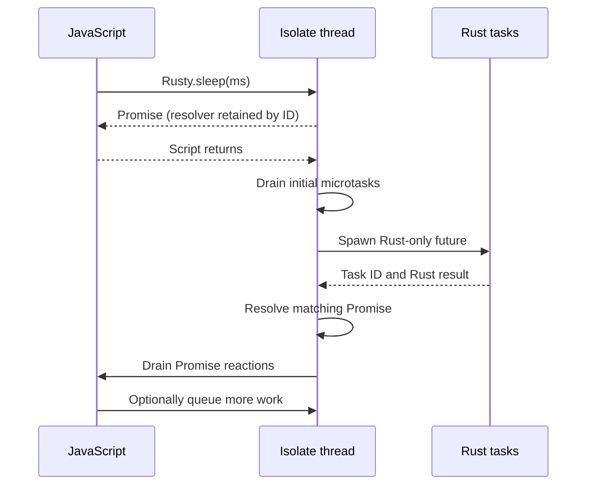

# How Tokio completes a JavaScript Promise

The implemented bridge has two owners: V8 owns JS state on one thread; Tokio owns
Rust futures. The boundary between them is an operation ID and a Rust result.
Read [the API contract](api.md) first for supported behavior and cancellation.

## Walkthrough in execution order

1. `JsRuntime::new` sets V8's microtask policy to `Explicit`, registers a Promise
   rejection callback, and puts an isolate-local state reference in a typed slot.
   Native callbacks can find that state without raw embedder pointers.
2. `Rusty.sleep` reads a primitive Number and checks the delay. Avoiding coercion
   prevents argument validation from unexpectedly running guest `valueOf` code.
3. It creates a `PromiseResolver` and returns the associated Promise to JS. A
   `Global<PromiseResolver>` goes into the operation registry before the callback
   scope ends. That persistent root keeps the resolver reachable across scopes.
4. A monotonically increasing ID links the resolver to a queued Rust future.
   The future captures a deadline, not a V8 handle. No Tokio timer is polled
   inside the V8 callback. The callback returns promptly.
5. `execute` finishes the synchronous script and explicitly runs a microtask
   checkpoint. Promise reactions run until the queue is drained. This is separate
   from polling Rust futures.
6. `run_event_loop` drains the request queue into a Tokio `JoinSet`. Each task ID
   is associated with its operation ID. This avoids assuming tasks complete in
   registration order.
7. The root future awaits the next task completion with every V8 scope closed.
   The current-thread executor can now drive timers and other ready Rust tasks.
8. On completion, `settle` removes the matching operation, enters a fresh V8
   context scope, and resolves its Promise with `undefined` or rejects it with a
   host Error. The persistent resolver root is then released.
9. Another microtask checkpoint runs the resulting JS reactions. A reaction may
   enqueue more host operations, which the next loop iteration starts.
10. When no tasks, queued requests, or callback timers remain, the loop returns. A Promise created
    solely in JS has no host operation and does not prevent idle exit.

The callback timer slice adds another event source to this loop: the earliest
live timer deadline. That branch invokes the registered function on the isolate
thread and performs a checkpoint. [The timer walkthrough](timers.md) explains its
ordering, cancellation, and interval rearming policy.

## Why rejection tracking is part of the bridge

The pinned V8 binding documents that microtask checkpoints swallow callback
exceptions. A thrown Promise reaction becomes a rejected child Promise, so a
successful `Script::run` is insufficient evidence that the whole turn succeeded.

The rejection callback retains candidates using Promise identity. A later
handler-added notification removes its candidate. At the end of the checkpoint,
any remaining candidate becomes a `JsError`. This catches errors from both initial
Promise reactions and reactions triggered by a completed Tokio task.

The callback collects roots only; it does not stringify arbitrary rejection
values or report immediately. Reporting at the boundary gives handlers attached
by another microtask in the same checkpoint time to run. Only the first remaining
failure is returned, and the rest of that run's host work is cancelled.

## Cleanup and failure ownership

- `JoinSet` owns active Tokio tasks and aborts them when the event loop is dropped.
- `LoopGuard` releases pending resolver/rejection roots, timer callbacks/arguments, and queued requests even
  if the awaiting caller cancels the event-loop future.
- Dropping `JsRuntime` clears state and removes the isolate slot before the
  isolate is disposed. The context root also drops before the isolate field.
- Operation IDs are not reused during a runtime's lifetime. An obsolete completion
  without a registry entry cannot settle a newly registered Promise.
- A Tokio task panic or cancellation is a failed operation, not an invisible
  unfinished task. Its Promise is rejected on the isolate thread.

This does not forcibly stop a blocking native function. Future CPU/native modules
will need cooperative cancellation or a stronger process boundary where required.
The present built-in uses an asynchronous Tokio timer.

## Regression evidence

The library tests check reverse completion order using a channel-controlled pair
of Rust futures, failure and panic rejection, cancellation/root cleanup, stale
completion handling, definition-file diagnostics, and subsequent context reuse. CLI tests check script /
microtask / timer ordering, nested host work, strict delay validation, same-checkpoint
rejection handling, and failure status for unhandled rejections.

These tests prove the initial bridge on the local platform. They do not establish
fairness under unbounded JS, resource isolation, throughput, or platform support
beyond the environments actually tested.
