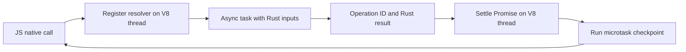

# Runtime design: Phase 0

Status: the initial CLI, context, native logging, and exception boundary are
implemented in `src/`. Explicit microtask scheduling, the Promise bridge, and
checkpoint rejection detection, and callback timers are implemented.
V8 is pinned to 152.2.0 and dependencies are
recorded in `Cargo.lock`. Hamza authorized implementation assistance on 2026-11-17.

Phase 1 now adds a separate isolate-local module map containing file/built-in IDs,
compiled module handles, resolved graph edges, and entry evaluation Promises.
Dynamic import requests and resolver roots stay in that map on the owner thread.
The host loads requests outside V8 callbacks, observes evaluation, settles import
Promises, and checkpoints again. Active entry evaluation is checked after those
steps and before idle exit. See [module design](modules.md) for cache lifetime,
file URL semantics, metadata, idle recovery, and cancellation semantics.
Native modules use V8 synthetic modules and captured native function handles;
the [built-in walkthrough](builtins.md) explains their lifetime and exports.

## Decision: one thread owns JavaScript

Use a current-thread Tokio runtime and run V8 on that thread. The root async
execution path can own the isolate without spawning an isolate-owning task.
Add a `LocalSet` only when non-`Send` local spawned tasks become necessary.

[Tokio's runtime documentation](https://docs.rs/tokio/latest/tokio/runtime/struct.Runtime.html)
distinguishes entering a runtime from driving it with `block_on`. For this design,
that distinction is the reason the host must explicitly keep polling async work.
[V8's isolate documentation](https://docs.rs/v8/latest/v8/struct.Isolate.html)
documents its thread constraints. Keep creation, access, and destruction together.

Tokio handles Rust futures; V8 handles JS execution and Promise reactions. Adding
Tokio does not itself provide a JavaScript event loop, timers, or preemption.

## Responsibilities, before introducing abstractions

| Responsibility | Owns | Must not own |
| --- | --- | --- |
| CLI boundary | Arguments, input path, process exit decision | Guest exception handling policy hidden in `unwrap` |
| JS execution boundary | Isolate/context entry, source origin, compile/run outcome | An open scope across an async suspension |
| Host operation registry, introduced at step 7 | Operation IDs and persistent Promise resolvers | Detached work with no completion accounting |
| Async host task | Owned Rust inputs and an eventual result | Access to the V8 heap |
| Completion processing | Result conversion, Promise settlement, cleanup | A second owner of the isolate |

The current implementation uses a library and CLI. Split additional modules only
when an ownership or testing problem justifies doing so.

## First change: Tokio alongside the existing runner

The CLI constructs the current-thread runtime and drives a root future. The library
regression test awaits a Rust timer between two script executions and verifies the
same JS context survives. V8 scopes end before suspension. Native logging is a
callback installed when the context is created.

The subsequent async slice adds an operation registry and Rust-only requests in
`src/async_ops.rs`. It uses Tokio tasks without a `LocalSet`: task futures never
contain V8 state. The detailed walkthrough is in [async runtime](async-runtime.md).

## Promise bridge contract for step 7

The native call returns a Promise promptly. The runtime retains its resolver until
the operation completes or is cancelled. Completion carries an operation ID and a
Rust success/error value. The host converts the result inside a fresh V8 scope,
settles the Promise, and removes the registry entry exactly once.

Design choice: keep persistent handles in the registry on the isolate thread even
if the chosen binding version permits moving some handle types. A persistent
handle extends reachability; it does not grant unrestricted heap access.
[V8's Global documentation](https://docs.rs/v8/latest/v8/struct.Global.html)
explains the lifetime and access restrictions. Do not use raw handles to evade
the ownership model.

For step 6, the runtime uses explicit microtask scheduling and checkpoints after top-level
execution and each completed host callback. Reactions may enqueue further work;
re-evaluate liveness afterward. [V8's microtask policy documentation](https://docs.rs/v8/latest/v8/enum.MicrotasksPolicy.html)
describes explicit and automatic scheduling.

Wait for real host work when no completion is ready. Do not busy-spin on a pending
Promise. An otherwise idle unresolved Promise is not a host operation and does not
keep the runtime alive. A pending timer or referenced host operation does.

## Errors and shutdown

At step 5, catch ordinary compile/runtime exceptions at the JS execution boundary
and produce a host-owned diagnostic with filename, message, and available location
and stack. A guest exception must not become a Rust panic. The CLI may exit with
failure after reporting it; a reusable execution boundary returns the diagnostic
so its caller can decide whether to continue.

At step 7, async operation failures reject their Promise. Cancellation must release
the retained resolver, and late completions must not access a disposed isolate or
settle a newer operation accidentally. Account for task panics and closed channels;
neither may leave a phantom active operation forever.

Stop accepting work before teardown, cancel tracked async work, and release all
persistent handles before dropping the isolate. CPU work dispatched later to a
blocking pool needs cooperative cancellation; aborting a task does not forcibly
stop an already running blocking function. See [Tokio shutdown behavior](https://docs.rs/tokio/latest/tokio/runtime/struct.Runtime.html#shutdown).

## Regression matrix

Rows through step 7 and the same-checkpoint rejection case are covered by the
library/CLI tests. Callback timer checks are also covered. See Phase 0 progress for
actual validation results.

Callback timers use the same isolate-local state but retain callback/argument roots
instead of Promise resolvers. The event loop waits for the earliest Tokio deadline
or a host task completion; it never sends callback handles to Tokio tasks.
[Timer design](timers.md) documents the fixed-delay interval policy and cancellation.

| Step | Probe | Required observation |
| --- | --- | --- |
| 3 | Existing inline and file scripts | Same results as the recovered baseline |
| 3 | Await a Rust timer | Completion observed before normal shutdown |
| 3 | Record thread identity | Isolate creation, execution, and drop share the owning thread |
| 4 | Logging a string and several values | Defined conversion/order; no crash if conversion throws |
| 5 | Syntax error and explicit throw | Controlled diagnostics with the supplied file origin |
| 5 | Execute valid JS after a caught error | Reusable boundary remains usable |
| 6 | Chained Promise reactions | Expected reaction order before idle exit |
| 7 | Host success and failure | Correct Promise settlement once; registry returns to empty |
| 7 | Two operations finishing in reverse order | Each result reaches its own resolver |
| 7 | Cancellation followed by late completion | No stale access, leaked resolver, or duplicate settlement |
| 7 | JS-only unresolved Promise with no host work | Runtime reaches idle instead of spinning |
| 8 | Cancel timer; cancel interval from callback | No later callback for the cancelled registration |
| 9 | Rejection caught during the same checkpoint | No premature unhandled-rejection report |

Do not use exact wall-clock timer assertions. Record actual failures and commands
as each step is implemented; postpone cross-platform claims until the same checks
pass on Windows, macOS, and Linux.
